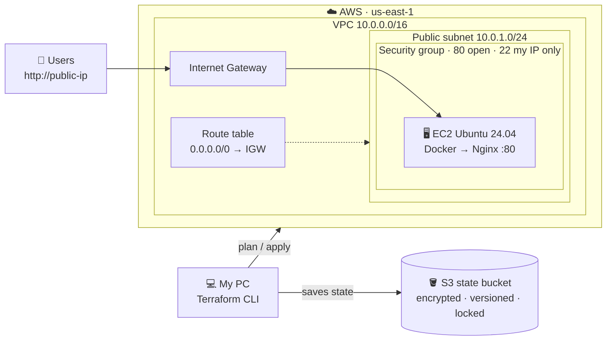

# 🏗️ Terraform: Infrastructure as Code on AWS

**One command builds a complete AWS environment. One command deletes it.**

This project uses **Terraform** to create a full AWS setup from code (network, firewall and a web server running Docker) instead of clicking in the AWS Console. The code lives in Git, so every change is reviewed, tracked and repeatable.

---

## 📑 Table of Contents

1. [What This Project Does](#-what-this-project-does)
2. [Architecture](#-architecture)
3. [Tech Stack](#-tech-stack)
4. [Project Structure](#-project-structure)
5. [How It Works](#-how-it-works)
6. [Quick Start](#-quick-start)
7. [Inputs and Outputs](#-inputs-and-outputs)
8. [CI Pipeline](#-ci-pipeline)
9. [Security](#-security)
10. [Troubleshooting](#-troubleshooting)
11. [What I Learned](#-what-i-learned)
12. [Future Improvements](#-future-improvements)
13. [Author](#-author)

---

## 🎯 What This Project Does

| Problem (manual Console work) | Solution (Terraform) |
|---|---|
| Nobody remembers which settings were clicked | Every setting is written in code |
| Test and production slowly become different | The same code builds the same environment every time |
| No history of who changed what | Every change is a Git commit |
| Forgotten resources keep costing money | `terraform destroy` removes everything |

**Terraform creates 11 AWS resources:**

- 🌐 **VPC** (`10.0.0.0/16`): a private network
- 🚪 **Internet Gateway**: the network's door to the internet
- 📦 **Public subnet** (`10.0.1.0/24`) + **route table** + **association**
- 🔥 **Security group** + **3 rules**: HTTP (80) open, SSH (22) from my IP only, all outbound allowed
- 🔑 **Key pair**: my public SSH key
- 🖥️ **EC2 server** (Ubuntu 24.04, `t3.micro`) that installs **Docker** and runs **Nginx** at first boot

---

## 🗺️ Architecture

---

## Tech Stack

| Area | Technology |
|---|---|
| Infrastructure as Code | Terraform (HCL), AWS provider `~> 6.0` |
| Cloud | AWS: VPC, EC2, S3, Security Groups |
| Server | Ubuntu 24.04 LTS |
| Containers | Docker, Nginx |
